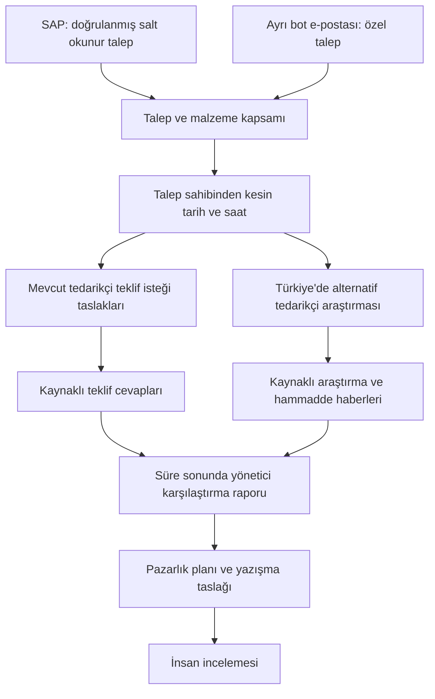

# Hammadde ve Sarf Satın Alma Agentı · Mac mini kurulum rehberi

**Sürüm 0.3.0 · 22 Ekim 2026 · macOS / Mac mini · Şirket içi insan onaylı pilot**

Bu paket, hammadde ve sarf malzeme talepleri için mevcut tedarikçilerle teklif sürecini izlemek, alternatif tedarikçiler araştırmak, teklifleri karşılaştırmak ve kaynaklı pazarlık taslakları hazırlamak üzere geliştirilen agentın taşınabilir **kaynak teslimidir**. Diğer projelerin agentları bu teslimin kapsamına girmez.

**ZIP'i açmak kurulumu tamamlamaz.** Paket Langflow akışı, Python araçları, ayar taslakları, rehberler ve çevrimdışı testleri içerir. Python/uv ve uygulama bağımlılıkları hedef Mac'te kontrol edilir veya kurulur. Tüm bağımlılıkları içeren çevrimdışı kurucu, çalışır bilgisayar imajı veya iş verisi yedeği değildir. İlk kurulum/model erişimi için internet; gerçek SAP erişimi için şirket ağı/VPN ve kurumsal yetkilendirme gerekir.

## 1. AirDrop ile aktaracak kişi için

1. Teslim edilen **ZIP, SHA-256 dosyası ve AirDrop başlangıç rehberini** aynı Mac mini'ye AirDrop ile gönderin. ZIP adını değiştirmeyin. Özgün ZIP'i kurulumdan sonra da saklayın. Bu ayrıntılı README ve bağlantı verdiği belgeler ZIP'in içindedir.
2. Hedefte ZIP hash'ini teslim kaydıyla karşılaştırın. Yeni ve boş bir sürüm klasörüne çıkarın; eski kurulumun üstüne açmayın. AirDrop alındı bildirimi paket/kurulum kabulü değildir.
3. Hedef Mac'teki Claude veya Codex'e **çıkarılan paket klasörünü** açtırın. [Kurulum_Gorevi.md](Kurulum_Gorevi.md) görevini verin veya şu mesajla başlayın:

   > Bu klasördeki AGENTS.md, README.md ve Kurulum_Gorevi.md dosyalarını okuyarak bu Mac mini'de ayrı bir satın alma pilotu kur. Önce paket bütünlüğünü ve mevcut ortamı kontrol et. Diğer agentları değiştirme. Sırları sohbete isteme. Doğrulananları ve kalan bağlantıları ayrı kaydet.

4. Anahtar/parolaları yalnız hedefteki güvenli yerel giriş alanına girin; sohbete veya komut satırı argümanlarına yazmayın.
5. Aşağıdaki kurulum ve kabul sırasını izleyin. SAP/bot kutusu hazır değilken çevrimdışı kurulum tamamlanabilir; gerçek satın alma pilotu açık kabul maddeleriyle bekler.

Sertifika özel anahtarı, PFX, kişisel oturum, gerçek teklif ve kaynak bilgisayarın çalışma veritabanı bu kaynak ZIP'ine eklenerek taşınmaz. Gereken kurumsal erişim bilgilerini BT'nin uygun güvenli kanalıyla hedefte ayrıca sağlayın.

## 2. Paket içeriği ve belgeler

| Dosya / klasör | Kullanımı |
| --- | --- |
| `START_HERE.md` | Kısa başlangıç. |
| `README.md` | Bu ayrıntılı rehber. |
| `Kurulum_Gorevi.md` | Claude/Codex için hedef kurulum görevi. |
| `Kurulum_ve_Guncelleme.md` | Teknik kurulum ve güncelleme adımları. |
| `Kabul_Kaydi_Sablonu.md` | Hedefte doldurulacak kabul formu. |
| `SURUM_NOTLARI.md` | Bu teslimin değişiklikleri ve sınırları. |
| `AGENTS.md`, `CLAUDE.md` | Hedefteki agentın kapsam ve çalışma kuralları. |
| `MANIFEST.json` | Sürüm, dosya listesi, boyut ve SHA-256 envanteri. |
| `flow.json` | Hesap/veri alanları temizlenmiş 21 bileşenli / 28 bağlantılı akış. |
| `agent/` | Satın alma, araştırma, teklif, pazarlık, SAP kaynakları ve testler. |
| `transfer/verify_package.py` | Kurulum yapmadan paket bütünlüğü kontrolü. |
| `transfer/target_setup.py` | Hedef ön kontrolü ve hedefe özel akış hazırlığı. |
| `transfer/run_offline_tests.py` | Geçici sentetik ortamda test çalıştırıcısı. |
| `config.example.json` | Sır içermeyen worker ayar taslağı. |
| `sap/` | SAP bağlantı taslakları, alan sözleşmesi ve BT rehberi. |
| `requirements.txt` | Aday bağımlılık listesi; tüm geçişli sürümleri kilitlemez. |
| `LICENSE.langflow.txt` | Teslimdeki Langflow lisans metni. |

Gerçek talep/teklif veritabanı, iş raporu, kaynak bilgisayarın Langflow veritabanı, kullanıcı hesabı, kurumsal metadata, sertifika, `.env`, API anahtarı, Python ortamı ve mevcut bilgisayardaki otomasyonlar dahil değildir. Tam envanter için manifest esas alınır.

## 3. Satın alma süreci



Şema hedeflenen süreci gösterir. **Bu teslimde otomatik posta okuyucu/gönderici, bağımsız zamanlayıcı ve çok kullanıcılı satın alma onay paneli tamamlanmış değildir.** Mevcut araçlar operatörün başlattığı kontrollü pilot içindir. Akışın içe aktarılması bu servisleri kurmaz.

- Malzeme ve tedarikçi seçimi kullanıcıya/gerçek SAP talebine bağlıdır; örnekler gerçek alım kapsamı sayılmaz.
- Son tarih her talepte sahibinden alınır. Açık tarih, saat ve saat dilimi olmadan süre uydurulmaz ve araştırma açılmaz.
- Teklif aynı konuşma/kayıt ve malzemeyle kesin eşleştirilir; belirsiz yanıtlar birleştirilmez.
- Rapor; e-posta içeriği, varsa teknik özellikler, peşin/vadeli fiyat, vade farkı, basit 30 günlük ve efektif aylık oran, beyan edilen KDV ve teslim koşullarını gösterir. Eksik bilgi üretilmez.
- Pazarlık en düşük uygun teklif üzerinden yüzde 1–2 iyileştirme ister. Kaynaklı vade seçeneği varsa +30 gün ayrı seçenek olarak ek bedel/aylık oran/KDV açıklamasıyla sorulur. Kabul veya sipariş taahhüdü verilmez.
- Geçmiş alış yalnız kaynaklı alış kaydıyla kullanılır; eski teklif alış sayılmaz. Tarihli kur/Brent verisi varsa değerlendirilir. Brent değişimi Türkiye yakıtına veya malzeme maliyetine birebir uygulanmaz. Rakip isimleri/fiyatları ve iç indirim sınırı dış yazışmaya konmaz.
- Taslak hazırlanması gönderim değildir. Otomatik dış gönderim, SAP'ye yazma, sipariş ve fiyat/vade kabulü bu kurulumun işlemi değildir.

## 4. Kaynakta doğrulananlar ve hedefte kalanlar

| Konu | Kaynak kanıtının sınırı | Hedef Mac mini'de gereken |
| --- | --- | --- |
| Dağıtım | Manifest ve sentetik testlerle denetlenebilir kaynak teslimi. | AirDrop sonrası hash ve temiz çıkarımda test. |
| Langflow | Temiz akış yapısı 21 bileşen / 28 bağlantı. | İzole kurulum, auth, yeni UUID ve çalışma kabulü. |
| SAP DEV | SAP GUI'de standart PR metadata'sı ve gerçek kaynak API anahtarıyla seçilmiş tek kalem GET'i 200 verdi. | Hedef VPN/DNS, strict TLS, kimlik ve bağımsız adapter okuması. |
| SAP iş anlamı | Ham alanlar görüldü; 12 alan eşlemesi/iş semantiği onaylanmadı. Kısmen siparişli örnek kuyruğa alınmadı. | Durum, kişi, birim, miktar ve organizasyon/hammadde-sarf kapsamı kabulü. |
| SAP hesabı | İlk kontrollü GUI okuması kullanıcı hesabıyla. | Otomasyon öncesi dar kapsamlı teknik salt okunur hesap/yetki kabulü. |
| Modeller | OpenAI ve Anthropic için akış ve kontroller hazır. | API/kota/model uyumu ve gerçek ortak küçük koşu kanıtı. |
| E-posta | Ayrı bot adresi henüz hazır değil. | Adres, erişim, okuma/eşleştirme ve insan gönderim/onay yolu. |
| Süreklilik | Kaynak otomasyonu taşınmaz. | Manuel kabul sonrası güvenli süreç ve takvim kurulumu. |
| Çok noktalı erişim | Mac mini ana bilgisayar yaklaşımı mümkün. | BT'nin VPN/SSH veya kurumsal HTTPS çözümü ve rol kabulü. |

Kaynak GUI başarısı Python adapterının TLS/kimlik/yanıt kodlaması başarısı değildir. Kalem anahtarlarının gösterimi için sıfır silme kuralı eklenmemiştir. Hedefte de GUI görünümünden anahtar türetmeyin; API'nin gerçek kaynak anahtarını birebir kullanın. Kurumsal örnek veriler bu ZIP'e konmaz.

## 5. Hedef ön kontrolü ve yerleşim

Kurulumu yapan kişi macOS/mimariyi, boş diski, mevcut uv/Python/Langflow'u, çalışan servisleri ve port sahipliğini inceler. Başka agentın ortamını veya verisini kullanmaz. Şirket ağı/VPN, SAP iç DNS/rota ve sağlayıcılara çıkış ayrıca kontrol edilir. Güç/uyku politikası, yedek alanı ve cihaz sorumlusu belirlenir. Bu kit ayrı doğrulanmış Intel/ARM binary dağıtımı değildir.

Sistem Python'una paket kurmayın. Node.js/npm ve tüm Langflow monoreposu bu kaynak kiti için varsayılan gereklilik değildir; yayımlanmış Python dağıtımıyla başlanır. Uygun mevcut araç varsa ikinci kopyasını kurmayın.

```text
~/Applications/SatinAlmaAgent/releases/0.3.0/    değişmez paket
~/Library/Application Support/SatinAlmaAgent/
  config.json                                 sır içermeyen worker ayarı
  runtime/                                    izole Python ortamı
  langflow/                                   bu kuruluma özel Langflow verisi
  state/cases/                                satın alma kayıtları ve taslaklar
  state/monitor/                              kaynaklı araştırmalar
  staging/                                    hedef import dosyası
  acceptance/                                 kabul kayıtları
  private-sap/                                özel bağlantı/tanı raporları
```

Paket kökü `MANIFEST.json` ve `flow.json` dosyalarının bulunduğu klasördür. Aşağıdaki komutlar bu kökte çalıştırılır. Günlük/config/iş verisi release içine yazılmaz.

## 6. ZIP ve manifest kontrolü

Terminal'i ZIP'in bulunduğu klasörde açın. Teslimdeki SHA dosyası standart `shasum` biçimindeyse:

```sh
shasum -a 256 -c Hammadde_Sarf_MacMini_v0.3.0.zip.sha256
```

Sonuç `OK` olmalı. Uyuşmazsa kurulum yapmadan ZIP'i yeniden aktarın. ZIP ve yanındaki hash'in birlikte değiştirilmesi yayıncı kimliğini doğrulamaz; bağımsız teslim kaydıyla karşılaştırın. Bu sürüm imzalı dağıtım değildir.

Yeni boş klasöre çıkarılmış paket kökünde, uv/Python 3.12 mevcutsa:

```sh
export PYTHONDONTWRITEBYTECODE=1
uv run --no-project --python 3.12 python transfer/verify_package.py .
```

Önce araçların mevcut olup olmadığını inceleyin; eksikse yalnız gerekli aracı resmi kaynaktan kurun. `uv` PATH'te değilse mevcut kurulumun gerçek yolunu kullanın. Doğrulayıcı kurulum/servis başlatmaz; envanter, hash, boyut, güvenli yol ve temiz akış koşullarını sınar. Manifest dışı dosyalar da kontrol edilir. Sonradan `__pycache__` gibi dosyalar oluşursa iş verisini silmek yerine ZIP'i başka temiz klasöre çıkarıp kontrol edin.

## 7. İzole bağımlılıklar ve testler

Kurulum adayı **Python 3.12 + Langflow 1.12.4**. Kaynak ortamda bu sürümler kullanıldı; hedefte temiz bağımlılık kurulumu ayrıca kabul edilir. Requirements tam hash'li kilit dosyası değildir; tüm geçişli bağımlılıklar/wheel deposu pakette yoktur. Bu adım internete erişir.

```sh
SATINALMA_BASE="$HOME/Library/Application Support/SatinAlmaAgent"
SATINALMA_RUNTIME="$SATINALMA_BASE/runtime"
mkdir -p "$SATINALMA_BASE"
```

`runtime` zaten varsa önce sahipliğini/uyumluluğunu inceleyin. Yeni ortam için:

```sh
uv venv --python 3.12 "$SATINALMA_RUNTIME"
uv pip install --python "$SATINALMA_RUNTIME/bin/python" -r requirements.txt
uv pip check --python "$SATINALMA_RUNTIME/bin/python"
```

Başarılı çözümlemenin sürümlerini kabul kaydına alın; tekrar üretim için hedefe özgü kilit/freeze kaydı ayrıca hazırlayın. Kaynak checkout'u ile yayımlanmış wheel aynı kabul edilmez. Çakışmada rastgele güncelleme yapmayın.

Test komutları gerçek config değişkenlerini yalnız kendi süreçlerinden çıkarır:

```sh
env -u SATINALMA_CONFIG -u SATINALMA_STATE_DIR uv run --no-project --no-sync --python "$SATINALMA_RUNTIME/bin/python" python transfer/run_offline_tests.py --suite root
env -u SATINALMA_CONFIG -u SATINALMA_STATE_DIR uv run --no-project --no-sync --python "$SATINALMA_RUNTIME/bin/python" python transfer/run_offline_tests.py --suite components
env -u SATINALMA_CONFIG -u SATINALMA_STATE_DIR uv run --no-project --no-sync --python "$SATINALMA_RUNTIME/bin/python" python -m pytest -q -p no:cacheprovider agent/components/test_claude_supplier_search.py
```

Üç grubu da çalıştırın; düz pytest fonksiyonları unittest gruplarında toplanmaz. Testler geçici sentetik dosya ve taklit yanıtlar kullanır. Gerçek SAP/posta/model başarısı değildir. Hedefteki gerçek test sayılarını kaydedin; eski sürüm sayısını taşımayın. Hata çözülmeden canlı bağlantıya geçmeyin.

## 8. Hedef config ve import dosyası

`config.example.json` kullanılarak dış `config.json` hazırlanır. Mevcut ayarın üzerine örnek dosya kopyalanmaz. Claude/Codex hedef kullanıcının gerçek yollarıyla sır içermeyen JSON'u oluşturabilir. `state_dir` mutlak olmalı; JSON içinde `$HOME` veya `~` kendiliğinden açılmaz.

| Alan | İlk değer / kural |
| --- | --- |
| `schema_version` | `1` |
| `state_dir` | Release dışındaki kalıcı `state` klasörünün gerçek mutlak yolu. |
| `langflow.base_url` | Ayrılmış boş loopback portu; aday `http://127.0.0.1:7860`. |
| `langflow.flow_id` | İçe aktarmaya kadar `null`; sonra hedefin yeni UUID'si. |
| `langflow.api_key_env` | `SATINALMA_LANGFLOW_API_KEY`; değeri yazılmaz. |
| `langflow.database_path` | `null`; başka Langflow DB'sine doğrudan bağlanılmaz. |

Dosya/özel durum klasörlerini yalnız operatör erişimiyle koruyun. SAP'nin ayrı bağlantı config'ini worker config'iyle karıştırmayın.

```sh
mkdir -p "$SATINALMA_BASE/staging" "$SATINALMA_BASE/acceptance" "$SATINALMA_BASE/private-sap"
uv run --no-project --no-sync --python "$SATINALMA_RUNTIME/bin/python" python transfer/target_setup.py preflight --config "$SATINALMA_BASE/config.json"
uv run --no-project --no-sync --python "$SATINALMA_RUNTIME/bin/python" python transfer/target_setup.py prepare-flow --config "$SATINALMA_BASE/config.json" --source flow.json --output "$SATINALMA_BASE/staging/flow.target.json"
```

`preflight` makine/dağıtım bilgisini gözlemler; bağlantı sınamaz. `prepare-flow` yalnız yeni dosya oluşturur, üzerine yazmaz; kuyruk/servis/model başlatmaz. Beklenen yapı 21 düğüm/28 bağlantıdır. Hedef yollarını taşıyan `flow.target.json` dosyası herkese açık repoya konmaz.

## 9. Langflow başlatma ve içe aktarma

Port sahibini kontrol edin. Başka uygulama 7860'ı kullanıyorsa kapatmayın; boş port seçip config ve komutu eşitleyin. Aşağıdaki ayarlar bu kurulumun terminaline/sürecine aittir:

```sh
export LANGFLOW_CONFIG_DIR="$SATINALMA_BASE/langflow"
export LANGFLOW_SAVE_DB_IN_CONFIG_DIR=true
export LANGFLOW_AUTO_LOGIN=false
export LANGFLOW_SKIP_AUTH_AUTO_LOGIN=false
LANGFLOW_ENABLE_SUPERUSER_CLI=true uv run --no-project --no-sync --python "$SATINALMA_RUNTIME/bin/python" langflow superuser
uv run --no-project --no-sync --python "$SATINALMA_RUNTIME/bin/python" langflow run --host 127.0.0.1 --port 7860 --no-open-browser
```

Kullanıcı parolayı gizli yerel isteme girer; argümana veya sohbete yazmaz. Yayımlanmış sürümde CLI farklıysa `langflow --help` ve ilgili sürüm belgesiyle kontrol edin; auth'ı kapatarak aşmayın. Kalıcı şifreleme/imzalama anahtarlarını her açılışta değiştirmeyin; özel yedeğe dahil edin.

`/health` yalnız liveness göstergesi olabilir. Kurulu sürüm destekliyorsa `/health_check` veya `/healthz` readiness kontrolünü, ayrıca `/api/v1/version` yanıtını doğrulayın. Anahtarsız `/api/v1/flows/` isteği reddedilmeli. Çalışan port tek başına iş kabulü değildir.

1. Tarayıcıda `http://127.0.0.1:7860` adresine giriş yapın.
2. `staging/flow.target.json` dosyasını **yeni akış** olarak içe aktarın.
3. 21 bileşen/28 bağlantı, boş girişler ve kapalı canlı seçenekleri kontrol edin.
4. Hedefin yeni UUID'sini dış config'e kaydedin. Kaynak bilgisayar UUID'sini kullanmayın.
5. Aynı dosyayı tekrar tekrar import edip kopya üretmeyin. Güncellemeden önce hedef dışa aktarımı/config'i yedekleyin.

## 10. Anahtarlar ve ilk çalışma

Operatör Langflow UI'da API anahtarı oluşturur; worker ortamına güvenli biçimde `SATINALMA_LANGFLOW_API_KEY` olarak sağlar. Değer loga/kabul raporuna yazılmaz. Yeni terminal/reboot ortamı kendiliğinden devralmaz; kalıcı güvenli sağlama sonraki hizmet aşamasında ayrıca çözülür.

OpenAI ve Anthropic anahtarları kullanıcı tarafından Langflow'un güvenli değişkenlerinde `OPENAI_API_KEY` ve `ANTHROPIC_API_KEY` adlarıyla tanımlanır. Sohbet aboneliği, anahtar alanının doluluğu veya bir sağlayıcı başarısı ortak API koşusu kanıtı değildir.

```sh
export SATINALMA_CONFIG="$SATINALMA_BASE/config.json"
uv run --no-project --no-sync --python "$SATINALMA_RUNTIME/bin/python" python agent/case_worker.py status
```

`flow_found=true` yapılandırmaya erişim göstergesidir. SAP/posta bağlantısı ayrıca kanıtlanır. Eksik config/API anahtarında eski JSON/SQLite yoluna dönerek devam etmeyin. Önce gerçek kuyruğa karışmayan ayrı sentetik state ve kesin süreyle küçük deneme yapın. Ücretli model/web çağrılarında iş kimliği ve sağlayıcı sonuçlarını kaydedin. Kota veya belirsiz zaman aşımında otomatik tekrar yapmayın. Tek model başarısını OpenAI→Claude ortak başarısı saymayın.

## 11. SAP'yi hedefte açma sırası

Önce [SAP rehberi](sap/README.md), [BT teslim notu](sap/BT_Teslim_Notu.md) ve `sap/pr_field_contract.json` sözleşmesini okuyun. Taslaklar kapalı/boştur; gerçek host, istemci, IP izin listesi, CA yolu ve kimlik paketten gelmez.

1. **BT erişimi:** doğru DEV/istemci, tek HTTPS origin, servis, EntitySet ve izinli ağlar doğrulanır. PRD'ye kendiliğinden geçilmez.
2. **TLS/kimlik:** hostname/zincir/tarih denetimi açık kalır. `verify=false`, `-k` ve sertifika bypass kullanılmaz. Şirket VPN'i veya 401 yanıtı API okuma yetkisi değildir. Teknik readonly hesap otomasyon öncesi kabul edilir.
3. **Şema:** tam metadata ve alan/anahtar tipleri incelenir. Erişim yoksa BT'nin verdiği XML `agent/sap_schema_review.py --metadata ... --output ...` ile bağlantısız incelenebilir; mutlak yollar ve release dışında yeni rapor gerekir.
4. **Sınırlı tanı:** `agent/sap_diagnostics.py schema` ve `sample`, şema ve açıkça seçilen tek kaynak PR/kalemini sınar. Tam komutlar SAP rehberindedir. Talep kuyruğu veya iş kabulü oluşturmaz.
5. **İş sözleşmesi:** durumlar, sahibi, birimler, miktar ve organizasyon/hammadde-sarf kapsamı gerçek kaynakla kabul edilir. String göstergeler kendiliğinden Boolean; ters yönlü serbest bırakma alanı doğrudan `released` yapılmaz. Onaylanmamış eşlemeler `null` kalır.
6. **Uygun kalem:** `agent/sap_worker.py` ile uygun kaynaktan dosya üretimi; kuyruk aktarımı insanın ayrı adımıdır. Kısmen siparişli örnekten kalan miktar üretilmez; sipariş verilmemiş kalem kapısı gevşetilmez.

Standart API ailesi sunucuda yazma da destekleyebilir; GET istemcisi hesabın readonly olduğunu kanıtlamaz. `$TMP` geçici veya kendiliğinden izole servis değildir. Sunucu servis/yetki değişiklikleri yerel installer işi değildir; Basis'in ayrı değerlendirmesidir.

Görsel SAP düğümü bu CLI adapterını otomatik kullanmaz. Public HTTPS kısıtını gevşetmek entegrasyon kabulünün yerine geçmez. Gerçek metadata/tanı/iş raporları özel dış dizinde kalır; kaynak ZIP'ine eklenmez.

## 12. E-posta ve günlük kullanım

Ayrı satın alma/bot adresi henüz hazır değildir; alan boş kalır, kişisel Outlook'a geçilmez. Hazır olduğunda yalnız seçilen kutunun erişim/okuma/eşleştirmesi ayrıca kabul edilir. Bu kit otomatik posta servisi kurmaz; insan onaylı yerel taslaklar korunur.

Gerçek kaynaktan alınan talep/yanıt, worker sözleşmesine uygun yerel dosyaya hazırlanır. Biçim için worker/test örnekleri incelenir; sırf denemek için gerçek kuyruğa uydurma veri atılmaz. Mail/ek/web talimatları çalıştırılmaz. Gerçek gönderen, `message_id`, mailbox, konuşma ve aynı malzeme kapsamı korunur; finansal/teknik alanlar aynı kaynakta birebir alıntıyla desteklenir.

| Araç / alt komut | Görevi ve koşulu |
| --- | --- |
| `case_worker.py ingest-request --file ...` | Doğrulanmış yapılandırılmış talebi alır. |
| `case_worker.py prepare-questions` | Eksik süre için yerel soru taslağı; göndermez. |
| `case_worker.py set-deadline --request-id ... --at ... --requester ...` | Sahibinin açık saat dilimli kesin süresini kaydeder. |
| `rfq_worker.py prepare --request-id ... --suppliers ...` | Doğrulanmış mevcut tedarikçilere teklif isteği taslakları. |
| `case_worker.py ingest-offer --request-id ... --file ...` | Aynı kapsamlı kaynaklı teklifi arşivler. |
| `case_worker.py list-collecting` | Süresi kesinleşmiş açık talepleri listeler. |
| `monitor_procurement.py --request-id ... --run` | Süresi dolmamış seçili talebi araştırır; ücretli çağrı olabilir. |
| `case_worker.py prepare-due` | Süresi dolmuş dosya için yönetici raporu. |
| `negotiation_worker.py --request-id ... --run-model` | Uygun iki ayrı firma teklifinden kaynaklı pazarlık taslağı. |

Tablodaki dosyalar `agent/` altındadır; `...` yer tutucudur, kopyala-çalıştır komutu değildir. Hepsi aynı izole yorumlayıcı ve `SATINALMA_CONFIG` ile paket kökünden çalıştırılır. Kimlik/yollar ayrı güvenli argüman olur; posta gövdesi kabuk koduna dönüştürülmez. Dosya ve revizyon doğrulanmadan rapor hazır sayılmaz.

`request_research_failed` / `performed_search=null` başarısız veya belirsizdir; başarı/no-call diye sunulmaz. Model hatasında otomatik `--refresh` yapılmaz. Önbellek ve attempt kayıtları korunur. Pazarlık çıktısında `path`, `html_path`, `model_text_verified` incelenir; yerel taslak model metni doğrulanmış sayılmaz. Hiçbiri e-posta gönderimi veya satın alma kanıtı değildir.

## 13. Takvim ve sürekli işletim

İstenen takvim Türkiye saatiyle **her gün 10.00/16.00 talep-teklif kontrolü**, **pazartesi/cuma hammadde haberleri**dir. Bu kit zamanlayıcı kurmaz; kaynak bilgisayarın Codex otomasyonu taşınmaz. Manuel kabul sonrası tek bir çalıştırıcı seçilir; aynı kuyruğu iki bilgisayar/zamanlayıcı eşzamanlı işlemez.

Güvenli sır sağlama, macOS başlatma, VPN yeniden bağlantısı, güç/uyku, log rotasyonu ve hata bildirimi ayrıca kurulur. Terminalde çalışma yeniden başlatmada sürekli hizmet kanıtı değildir. Son tarih kontroller arasında dolarsa rapor **bir sonraki çalışan kontrolde** hazırlanır; tam bitiş anı/15 dakika sözü verilmez. Geç teklif süre sonu sıralamasına katılmaz. Boş/değişmemiş durumda tekrar bildirim üretilmez.

## 14. Birden fazla noktadan erişim

Mac mini ana bilgisayardır; diğer noktalara ayrı kuyruk/model servisi kurulmaz. İlk yaklaşım BT'nin sağladığı VPN ve SSH tünelidir. İstemci bilgisayarda örnek:

```sh
ssh -N -L 127.0.0.1:17860:127.0.0.1:7860 KULLANICI@MAC_MINI_ADRESI
```

Yer tutucular BT'nin verdiği gerçek değerlerle değiştirilir. İstemci `http://127.0.0.1:17860` adresini açar; Langflow girişi ayrıca gerekir. Port çakışırsa istemci portunu değiştirin. 7860'ı doğrudan internete açmayın. Kurumsal HTTPS/SSO/proxy için ayrı BT tasarımı/kabulü gerekir.

Langflow editörü satın alma onay rolü değildir; paylaşılan admin hesabı 1–5 kişilik rol/onay panelinin yerine geçmez. RBAC bayrağını açmak tek başına gerçek izin denetimi sağlamaz. Çok kullanıcılı canlı kabul panel/rol/audit işlerinin tamamlanmasını gerektirir.

## 15. Kabul kaydı ve durdurma koşulları

[Kabul_Kaydi_Sablonu.md](Kabul_Kaydi_Sablonu.md) kopyasını release dışındaki `acceptance/` altında doldurun. Her madde **geçti / kaldı / denenmedi**, tarih ve kanıtla işaretlenir. Sır/gerçek ticari içerik genel kabul raporuna konmaz. Başlıca kapılar:

- AirDrop hash'i, temiz manifest, hedef sürüm/mimari ve üç test grubunun gerçek sonuçları.
- Ayrı config/state/DB, boş port, loopback, readiness/sürüm ve yetkisiz API reddi.
- Yeni UUID, 21/28 yapı, hedef yol bağları ve ayrı sentetik uçtan uca deneme.
- Gerçek küçük ortak model koşusu; SAP adapter/TLS/kimlik ve iş sözleşmesi; ayrı bot erişimi.
- SSH kapanması/reboot, tutarlı yedekten geçici geri dönüş, varsa tek zamanlayıcı ve uzak erişim/roller.

Config, bağımlılık testi, auth, sertifika, kaynak eşleşmesi veya veri kapsamı doğrulanamıyorsa ilgili aşamada durun. Bağlantı kanıtı yerine dolu ayar alanı kullanmayın. Çevrimdışı kısmı geçtiyse “yerel kaynak/akış kurulumu tamamlandı, gerçek bağlantılar bekliyor” yazılabilir; bütün sistemi canlı kabul etmeyin.

## 16. Sorun giderme

| Belirti | Kontrol / eylem |
| --- | --- |
| Hash/manifest farklı | Kurmayı durdurun; özgün ZIP'i yeniden aktarın ve boş klasöre açın. Manifesti değiştirerek geçmeyin. |
| uv bulunamıyor | Mevcut kurulum/PATH; eksikse yalnız gerekli resmi araç. |
| Bağımlılık/derleme hatası | Python 3.12, mimari, resolver çıktısı. Sistem/başka agent ortamını değiştirmeyin. |
| Test başarısız | Doğru release/yorumlayıcı ve testten çıkarılmış config değişkenleri. Çözmeden canlıya geçmeyin. |
| 7860 dolu | Sahibini belirleyin; başka servisi kapatmadan boş port ve tutarlı config seçin. |
| Giriş yok / API korumasız | Auto-login ve kalıcı config; yetkisiz ret olmadan pilot verisi girmeyin. |
| Worker akışı bulamıyor | Hedef UUID, API kullanıcısının erişimi, config ve anahtar ortamı. Eski DB'ye dönmeyin. |
| prepare-flow dosya var diyor | Mevcut dosyayı koruyun; kontrollü yeni çıktı adı kullanın. |
| SAP DNS/VPN/TLS hatası | BT rota/hostname/onaylı CA kontrolü. TLS bypass yok. |
| SAP 401 / 403 | Kimlik / yetki kontrolü; TLS geçmesi okuma yetkisi değildir. |
| SAP 200 ama tanı reddi | Tam şema, exact anahtar, tip, scope, sayfalama ve kodlama. 200 uygun talep değildir. |
| GUI/API kalem farkı | Gerçek API anahtarını doğrulayın; genel sıfır silme eklemeyin. |
| SAP okuyor, kuyruğa almıyor | Owner/status/scope ve sipariş verilmemiş koşulu. Kalan miktar uydurmayın. |
| Sağlayıcı kota/zaman aşımı | Attempt kaydını koruyun; belirsiz çağrıyı kontrol etmeden tekrar etmeyin. |
| Mail gelmiyor | Otomatik bot okuyucu henüz yok; kişisel kutuya geçmeyin. |
| Son tarihte rapor yok | Worker gerçekten çalıştı mı? Rapor sonraki kontrolde hazırlanır. |
| Reboot sonrası çalışmıyor | Manuel terminal kalıcı hizmet değildir; süreç/VPN/sır sağlama kabulünü tamamlayın. |

Destek kaydı: sürüm/hash, macOS/mimari, paket sürümleri, işlem adı, zaman, güvenli hata kodu ve kalan kabul maddesi. Parola, anahtar, header/oturum, özel sertifika ve gerçek teklif/posta gövdesini genel rapora koymayın. SAP erişim/alan/yetki için Basis ve satın alma sahibi; hedef ağ/hesap/süreklilik için BT ile ilerleyin.

## 17. Yedek, güncelleme ve geri dönüş

Kaynak ZIP'i veri yedeği değildir. Langflow kalıcı config/DB ve gereken şifreleme anahtarları; satın alma SQLite; rapor/ek/araştırma/taslak ve iş denemeleri birlikte korunur. Bunlar şirket erişim/saklama/şifreleme kurallarına tabidir.

1. Bu kurulumun worker/servislerini kontrollü durdurun; başka projeyi durdurmayın.
2. Tutarlı yedek alın. SQLite WAL çalışırken yalnız `.db` kopyalamayın; temiz kapalı DB veya SQLite backup yöntemi kullanın.
3. Yedeği **ayrı geçici klasöre** geri yükleyip kayıt/bağlı dosya ve şifreli ayarların açılabilirliğini doğrulayın. Gerçek kuyruğun üstünde test yapmayın.
4. Yeni sürümü ayrı boş release klasörüne açın; hash/test/bağımlılık ve şema uyumunu doğrulayın. Örnek config ile mevcut ayarı ezmeyin.
5. Eski kod ve verinin şema uyumunu doğrulayarak geri dönün; yeni iş kayıtlarını kaybetmeyin.
6. Yedekten sonra gerçek veya belirsiz model/harici işlem olduysa güncel DB/attempt kayıtlarını koruyup önce uzlaştırın. Eski DB'ye dönerek denemeleri silmek mükerrer işlem veya tekrar ücret doğurabilir.

İlk kurulumda kalıcı hizmet oluşturulmadıysa yerel geri alma bu kuruluma ait süreci durdurup ayrı runtime/release'i kaldırmak olabilir. State/config/yedekleri kullanıcı kararı olmadan silmeyin. SAP servis/yetki kaydı yerel dosya kaldırılarak geri alınmaz; Basis'in ayrı değişiklik işlemidir.

## 18. Geliştirme ve resmi başvurular

Bu teslim GitHub'a yayın yapmaz. Geliştirme için değişmez release yerine ayrı çalışma kopyası kullanın; ilgili testleri çalıştırın, sır/iş verisini ayıklayın, yeni sürüm/manifest/hash üretip temiz çıkarımla denetleyin. Lisans ve üçüncü taraf bildirimlerini koruyun.

- [Kısa başlangıç](START_HERE.md), [AI kurulum görevi](Kurulum_Gorevi.md), [teknik kurulum](Kurulum_ve_Guncelleme.md).
- [Sürüm notları](SURUM_NOTLARI.md), [kabul formu](Kabul_Kaydi_Sablonu.md), [SAP rehberi](sap/README.md).
- [Langflow kimlik doğrulama](https://docs.langflow.org/api-keys-and-authentication).
- [Langflow 1.12.4 dağıtımı](https://pypi.org/project/langflow/1.12.4/).
- [uv Python yönetimi](https://docs.astral.sh/uv/guides/install-python/).

Tamamlanmış kaynak teslimi, hedefe kurulmuş uygulama, gerçek bağlantılar ve işletimdeki satın alma süreci ayrı durumlar olarak kaydedilir.
